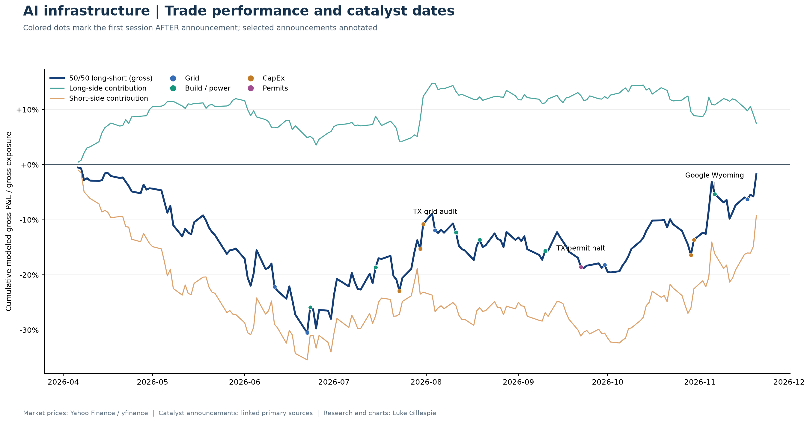
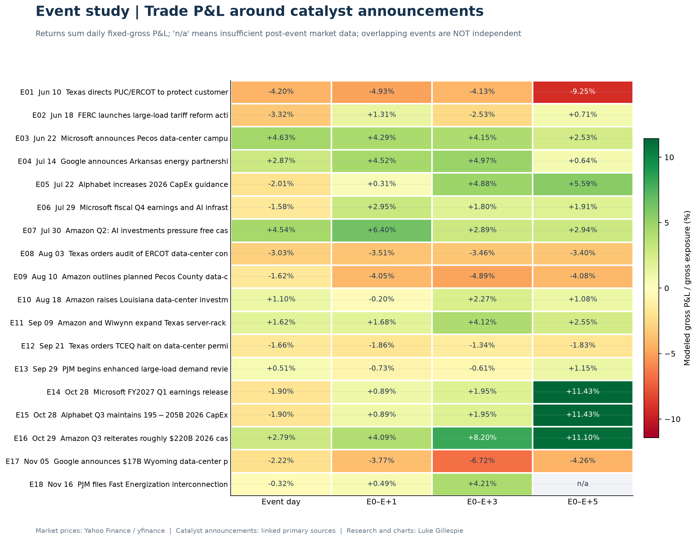
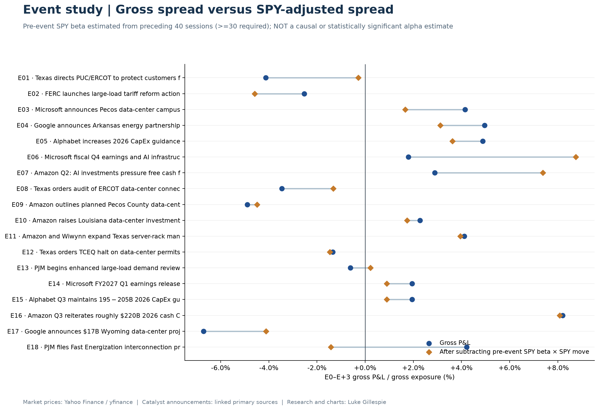

# AI Infrastructure Bottlenecks: Hyperscalers vs. Semiconductors

**Independent Investment Research | Python | Long/Short Equity | Relative Value | Portfolio Risk**

## Investment Thesis

This project investigates whether electricity infrastructure constraints, grid interconnection delays, permitting restrictions, and data-center construction bottlenecks could cause semiconductor equities to underperform hyperscale cloud platforms.

The central hypothesis is that constraints on AI infrastructure deployment may disproportionately affect semiconductor suppliers relative to large technology platforms with more diversified businesses.

The research combines fundamental catalyst analysis with quantitative relative-value modeling and portfolio risk management.

## Trade Construction

| Position | Securities | Allocation |
|---|---|---|
| Long | AMZN, MSFT, GOOGL | Equally weighted |
| Short | SMH, DRAM | 75% SMH / 25% DRAM |

The reference portfolio uses $50,000 long and $50,000 short exposure, representing $100,000 gross exposure and zero initial net dollar exposure.

**Original hypothetical trade entry:** November 5, 2026, closing prices.

## Research Methodology

### Part 1 — Historical Relative-Value Analysis

- Historical adjusted-price and return analysis
- Cumulative performance of both equity baskets
- Rolling correlations and relative performance
- Comparison of recent and earlier market regimes

### Part 2 — Quantitative Risk and Factor Analysis

- Rolling volatility and correlations
- Portfolio beta to the S&P 500
- Sharpe ratio and maximum drawdown
- Dollar-neutral versus beta-targeted portfolio construction
- Dynamic portfolio weights

### Part 3 — Scenario Analysis

- Hypothetical semiconductor selloffs and short squeezes
- Long-side and short-side profit attribution
- Financing and stock-borrow assumptions
- ETF distributions and trading costs
- Portfolio stress-testing visualizations

### Part 4 — Fundamental Catalyst Research

- Dated infrastructure and capital-expenditure announcements
- Grid interconnection, permitting, and power-supply developments
- Event studies examining portfolio returns around announcements
- Market-beta-adjusted performance comparisons
- Fundamental catalyst timeline and event-study visualizations

The event studies are descriptive. They do not establish causation, and selected, overlapping announcements limit statistical inference.

### Part 5 — Interactive Streamlit Dashboard

An interactive Python dashboard allows users to explore portfolio performance, risk metrics, exposure, scenario assumptions, and fundamental catalysts.

**Technology:** Python, pandas, NumPy, matplotlib, Plotly, yfinance, and Streamlit.

## How to Run the Research and Dashboard

**Recommended environment:** Python 3.12. From the directory containing these files:

```bash
python -m pip install -r requirements.txt
```

**Interactive dashboard (Part 5):**

```bash
python -m streamlit run dashboard.py
```

Streamlit will provide a local browser address (typically `http://localhost:8501`). Keep the terminal running while viewing the app. The app defaults to Yahoo Finance data and needs internet access. Select **Simulated demo** to check the interface without market-data downloads; simulated results must not be presented as historical returns. You may also upload a `Date, Ticker, Close, Adj Close` CSV in the dashboard.

**Jupyter notebook (Part 1):** Install JupyterLab if needed with `python -m pip install jupyterlab ipykernel`, then run `jupyter lab`, open `hyperscalers_vs_semiconductors.ipynb`, and run its cells. The committed notebook currently defaults to `DATA_SOURCE = "yahoo"`; use `"demo"` only for synthetic testing.

**Additional analysis scripts:** In Jupyter, first execute the Part 1 cells that create the `returns` DataFrame; then run:

```python
%run -i risk_and_factor_analysis.py
%run scenario_analysis.py
%run fundamental_catalyst_research.py
```

Part 2 depends on the notebook's live `returns` variable, Part 3 can run independently, and Part 4 retrieves Yahoo data and writes results into `part4_outputs/`. Internet access is required to re-download real data. Existing Part 4 CSVs and PNGs are provided for review without re-running its data download.

**Automated portfolio-engine tests:** Install `pytest` (`python -m pip install pytest`) and run:

```bash
python -m pytest -q tests
```

The six included unit tests check scenario P&L, deterministic demo prices, dividend reconciliation, forward-looking bias prevention in beta estimates, beta-target weights, and historical shock windows. They are **not** substitutes for end-to-end Streamlit testing or independent validation of all market data and event sources.

**Streamlit Community Cloud deployment:** Set the repository's app entry point to `dashboard.py` at the root. The root `requirements.txt` is used to install required packages. Deploy only after checking for sensitive information and verifying a clean app launch.

## Research Figures

The following figures are generated by the Part 4 catalyst study and included for convenient review:







The dated event catalog, supporting URLs, CSV outputs, and research limitations are in `part4_outputs/`. Source links and release timing should be independently reviewed before making causal claims.

## Selected Historical Findings

In the modeled common sample from May 19 to November 20, 2026:

| Metric | Dollar-neutral | SPY beta target |
|---|---:|---:|
| Cumulative modeled P&L | +$7,472 | +$2,928 |
| Realized SPY beta | -0.87 | -0.01 |
| Annualized volatility | 34.13% | 27.15% |
| Maximum drawdown | -21.32% | -17.91% |
| Annualized Sharpe ratio | 0.58 | 0.34 |

The dollar-neutral strategy displayed higher modeled returns but also greater market exposure and drawdown risk.

These are model results for the stated historical window, **not** the P&L from an executed IBKR position. They differ from the dashboard's shorter Nov 5 entry window and are not evidence of an independently validated trading strategy.

## Limitations

- Historical adjusted closing prices are not executable transaction prices.
- The models do not replicate actual Interactive Brokers share positions or transaction records.
- Some simulations assume daily rebalancing to target exposures.
- Carrying costs and execution expenses are estimates.
- Short borrowing conditions may change substantially.
- The DRAM ETF's limited trading history constrains the sample.
- Event-study relationships are associative, not causal.
- Historical backtests and hypothetical stress tests do not establish future profitability.

## Research Objective

The objective is not merely to identify a profitable trade, but to distinguish genuine relative-value opportunities from broader equity-market exposure, test adverse scenarios, and connect market performance to an economically grounded investment thesis.

**Research and analysis: Luke Gillespie**

**Market data:** Yahoo Finance / yfinance

**Status:** Independent historical research and hypothetical portfolio modeling. Not investment advice.
